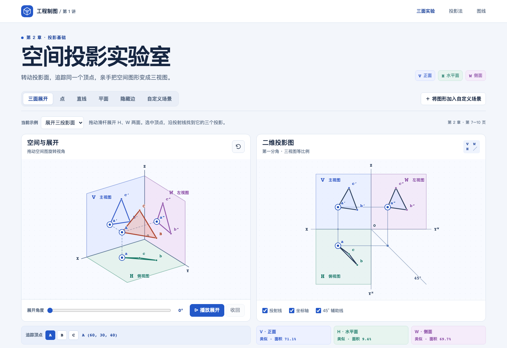

# Spatial Projection Lab

[简体中文](README.md) | [English](README.en.md)

An interactive learning tool for engineering drawing. Unfold the projection planes, track a vertex, and explore how points, lines, and planes in space become orthographic views.

Available as a static web application and offline desktop applications for macOS and Windows. Licensed under MIT. The application interface is in Simplified Chinese.



## Features

- **Unfold three projection planes.** Keep the frontal plane V fixed while rotating the horizontal plane H and profile plane W into the same plane. Use the 0°–90° slider or play the animation.
- **Track corresponding vertices.** Select a point in space or in a projected view to highlight its three projections. Toggle projection rays, coordinate axes, and the 45° transfer guide.
- **Study points, lines, and planes.** Compare true length, true shape, foreshortening, and projections that collapse to a point or line. Explore coincident projections and the difference between intersecting and skew lines.
- **Build custom scenes.** Add points, line segments, triangles, and planar polygons with 3–8 vertices. Edit coordinates and inspect the resulting projections.
- **Compare projection methods and drawing lines.** Switch between central projection, parallel orthographic projection, and parallel oblique projection. Inspect visible and hidden edges on a cuboid.

Custom scenes support up to 10 objects, with coordinates ranging from 0 to 100. Scenes are saved in the current browser or the current user's desktop application and can be restored after reopening.

## Run the web application locally

From the project root, start a static HTTP server. For example, with Python 3:

```sh
python3 -m http.server 8765 --bind 127.0.0.1 --directory dist
```

Open [http://127.0.0.1:8765/](http://127.0.0.1:8765/) in a browser. The application uses JavaScript modules and should be served over HTTP.

## Desktop applications

Extract the entire ZIP before opening the application. The desktop applications work offline and require no sign-in.

| Package | Target platform | Launch |
| --- | --- | --- |
| macOS Universal | macOS 13 or later, Apple Silicon and Intel | Open 空间投影实验室.app |
| Windows x64 | Windows 11, typically Intel or AMD PCs | Open ProjectionLab/ProjectionLab.exe |
| Windows ARM64 | Windows 11 on ARM | Open ProjectionLab/ProjectionLab.exe |

The macOS application uses an ad hoc signature and has not been notarized by Apple. The Windows applications do not have a publisher certificate signature. The operating system may ask you to confirm the source when opening a downloaded application.

Initial functional testing covered macOS 26.6.2 on Apple Silicon, its Intel slice through Rosetta, native Windows 11 ARM64 in Parallels, and Windows x64 emulation in that guest. macOS 13 and a physical Intel Mac have not been tested. The [desktop guide](desktop/README.md), currently in Chinese, records testing details and subsequent package checks.

### Build the desktop packages

Building these packages requires macOS, Xcode command-line tools, Node.js 24 or later, and pnpm 11.25.0.

From the project root:

```sh
cd desktop
pnpm install --frozen-lockfile
pnpm package
```

The build creates three ZIP files and a SHA256SUMS.txt file in desktop/release/. To build a single target, run one of:

```sh
pnpm package macos
pnpm package win-x64
pnpm package win-arm64
```

The first build downloads the official Electron runtimes. If verified runtime ZIPs are already available, set PROJECTION_LAB_ELECTRON_ZIPS to their directory. Keep their original filenames and verify them against the corresponding Electron release's SHASUMS256.txt before use.

## Implementation and extension

The web application uses HTML, CSS, JavaScript, and SVG. Electron and Electron Packager wrap the same web resources for desktop use.

- `dist/geometry.mjs` implements first-angle projection, unfolding, geometry validation, and edge visibility for the convex cuboid.
- `dist/examples.mjs` defines teaching examples with vertices, object types, labels, explanations, and course page references.
- `dist/diagrams.mjs` renders the spatial scene and equally scaled orthographic views. `dist/app.mjs` handles interactions and scene storage.
- `desktop/` contains the desktop entry point and packaging script. `.openai/hosting.json` records the existing Sites deployment configuration.

Contributions can improve explanations, fix issues, or add examples. When changing the projection calculations, verify that point `A(60,30,40)` maps to `V=(-60,-40)`, `H=(-60,30)`, and `W=(30,-40)` in the unfolded drawing. Also check a line perpendicular to V, which projects to a point, and a horizontal planar figure, whose H projection retains its true shape.

## Authorship and course references

LouisYZ defined the learning goals and feature direction. Codex assisted with implementation, debugging, and verification. Browser and desktop runtime checks were used during development.

The teaching content references Tian Ling's (田凌) *Engineering Drawing*, Lecture 1, covering Introduction sections 1.5–1.6 and Projection Fundamentals sections 2.1–2.3. See [course and visual sources](SOURCES.md), currently in Chinese, for the referenced pages and attribution.

The diagrams and application icon are drawn by this project's code. The introductory image is an actual screenshot of the application. The original course materials retain their respective rights and permissions.

## License

This project's code, graphics, and documentation are available under the [MIT License](LICENSE). Use, modification, redistribution, and commercial use are permitted subject to the license, including preservation of its copyright and permission notice.

Electron and other third-party components retain their respective licenses. See [third-party notices](THIRD_PARTY_NOTICES.md), currently in Chinese, for component versions and bundled license locations. The original upstream license texts accompany the desktop packages.

Copyright (c) 2026 LouisYZ.

## GitHub releases

Commit the source, lockfile, documentation, screenshots, and license files. Desktop ZIPs in desktop/release/ are excluded by Git ignore rules and can be uploaded as GitHub Release assets together with SHA256SUMS.txt.

For a downloaded release, check the ZIPs on macOS with:

```sh
shasum -a 256 -c SHA256SUMS.txt
```

On Windows, compute a ZIP's hash in PowerShell and compare it with the checksum list:

```powershell
Get-FileHash -Algorithm SHA256 .\ProjectionLab-1.0.0-Windows-x64.zip
```

See the [publishing guide](docs/RELEASING.md), currently in Chinese, for a repository description and a release checklist.
