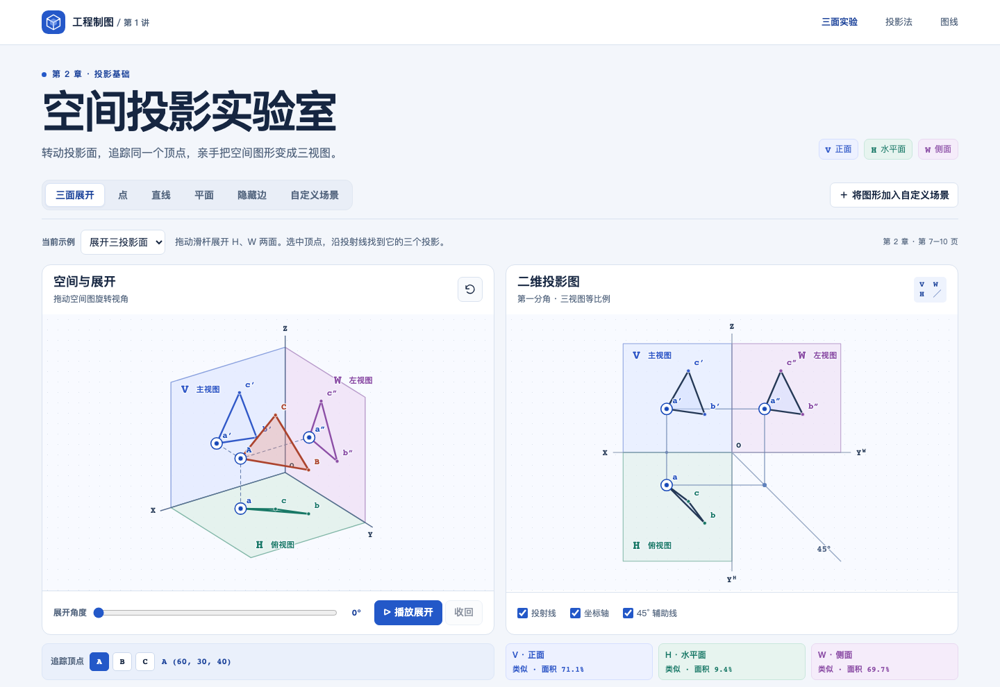

# 空间投影实验室

[简体中文](README.md) | [English](README.en.md)

一个工程制图互动学习工具。拖动投影面，追踪同一个顶点，观察空间中的点、线、面怎样变成三视图。

提供静态网页版和 macOS／Windows 离线桌面版，采用 MIT 许可证。



## 可以做什么

- **展开三投影面**，V 面固定，H 面和 W 面从空间转到同一平面，用 0°–90° 滑杆和播放按钮观察过程。
- **联动追踪顶点**，同时查看空间点及其三个同名投影，开关投射线、坐标轴与 45° 转向辅助线。
- **学习点、线、面投影**，比较实长、实形、缩短与积聚，观察重影点以及两线相交和交叉。
- **创建自己的场景**，添加点、线段、三角形和 3–8 顶点的平面多边形，编辑坐标并查看即时投影。
- **比较投影法和工程图线**，切换中心投影、平行正投影和斜投影，用长方体观察可见棱和隐藏棱。

自定义场景支持最多 10 个图形，坐标范围为 0–100。数据保存在当前浏览器或当前系统用户的桌面程序中，可在退出重开后恢复。

## 本地运行网页版

进入项目根目录，启动任意静态 HTTP 服务器。例如使用 Python 3：

```sh
python3 -m http.server 8765 --bind 127.0.0.1 --directory dist
```

在浏览器打开 [http://127.0.0.1:8765/](http://127.0.0.1:8765/)。页面使用 JavaScript 模块，通过 HTTP 服务器运行。

## 桌面版

完整解压对应的 ZIP 后打开程序，使用时无需联网或登录。

| 包 | 运行方式 |
| --- | --- |
| macOS Universal | macOS 13 及以上，Apple 芯片与 Intel 芯片共用一个 .app |
| Windows x64 | Windows 11，通常用于 Intel／AMD 电脑 |
| Windows ARM64 | Windows 11 ARM 电脑 |

安装、签名说明、重新打包命令和实际验收环境见 [桌面版说明](desktop/README.md)。

## 实现与扩展

网页使用原生 HTML、CSS、JavaScript 和 SVG。桌面版使用 Electron 和 Electron Packager，直接打包同一份网页资源。

- `dist/geometry.mjs` 计算第一分角投影、投影面展开、图形校验和凸长方体的棱可见性。
- `dist/examples.mjs` 定义教学示例。增加示例时填写顶点、图形类型、标签、说明和课程页码。
- `dist/diagrams.mjs` 将同一场景渲染成空间图与等比例三视图，`dist/app.mjs` 处理操作和场景存储。
- `desktop/` 提供桌面入口和打包脚本。`.openai/hosting.json` 记录现有 Sites 部署配置。

欢迎提交问题、改进讲解或增加示例。修改投影计算时，可用点 `A(60,30,40)` 核对展开图中 `V=(-60,-40)`、`H=(-60,30)`、`W=(30,-40)`，再检查正垂线积聚和水平面实形等典型情况。

## 课程来源与开发过程

项目由 LouisYZ 提出学习需求并确定功能方向，使用 Codex 辅助实现、排查问题和验证。开发中使用了浏览器及桌面程序运行测试，实际测试环境和局限记录在桌面版说明中。

课程知识参考田凌《工程制图》第 1 讲的绪论 1.5–1.6 与投影基础 2.1–2.3。具体页码、图形来源和授权范围见 [课程来源说明](SOURCES.md)。

## 许可证

本项目采用 [MIT License](LICENSE)，允许使用、修改、复制、分发和商业使用，分发时保留版权与许可声明。

Electron 等第三方组件按各自许可提供，详见 [第三方许可说明](THIRD_PARTY_NOTICES.md)。

## GitHub 发布文件

源码、锁文件、文档、截图和许可证可纳入仓库。桌面 ZIP 由打包命令生成在 `desktop/release/`，已加入 Git 忽略规则，适合作为 GitHub Release 附件发布。

[发布说明](docs/RELEASING.md) 包含建议的仓库介绍、发行文件和下载校验方式。
